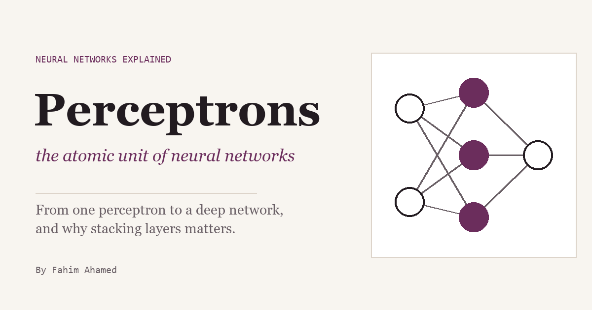

# Perceptrons, the Atomic Unit of Neural Networks

[](https://f-a-tonmoy.github.io/nn-explainer/)

**Live:** https://f-a-tonmoy.github.io/nn-explainer/

An interactive explainer that follows one artificial neuron from a single perceptron to a deep network: the learning rule, why one neuron can't learn XOR, backpropagation, universal approximation, and what depth buys. Every number on the page is computed live in your browser.

`index.html` is one self-contained page (only Google Fonts load from outside). It is generated, so edit `src/` and rebuild.

## Files

- `src/content.html`: all prose, figure markup and sources.
- `src/nn.js`: the math (perceptron rule with cycle detection, exact best-line accuracy, MLP with backprop, Adam/GD, ReLU construction, exact piecewise-linear piece counting, the shallow-vs-deep experiment). No DOM. The page, the Web Workers, and the tests all load this file.
- `src/app.js`: the interactives, canvas charts and network diagrams.
- `src/style.css`: styles.
- `build.js`: inlines the three files into `content.html` and writes `index.html`. Set `SITE_URL` to make the share-preview links absolute.
- `og.png`: the 1200×630 link-preview image, drawn by a local script that isn't in the repo.
- `test/nn.test.js`: self-checks for the math, including that the side-by-side demo matches the full experiment.

## Commands

Run from this folder.

```bash
node build.js
node --test test/nn.test.js
python -m http.server 8123
```

Then open http://localhost:8123. Serve over http, not `file://`: the Web Workers are built from Blobs, which need http.

## Publishing

`node build.js` writes the share-preview tags with the live address, so LinkedIn and other sites can load the preview image. To build for a different address, set `SITE_URL` first, e.g. in PowerShell:

```powershell
$env:SITE_URL="https://other.example/"; node build.js
```

GitHub Pages serves this repo from `main`, at the root.

## The shallow-vs-deep experiment

The side-by-side animation trains one random start (seed 1) in a Web Worker when the figure scrolls into view. The full experiment is in the collapsed panel below it, also in a Web Worker. **Export JSON** saves the settings, a per-model summary, and every seed's train MSE, held-out MSE, and loss curve. **Export CSV** saves one row per model × seed with all settings as columns. Fixed settings that have no control: 256 training points and 1,000 held-out points, both uniform on [0, 1] (data seeds 0 and 1); full batch; MSE; PyTorch-default init. At the default size, a run takes about 3 seconds per seed for both models.
